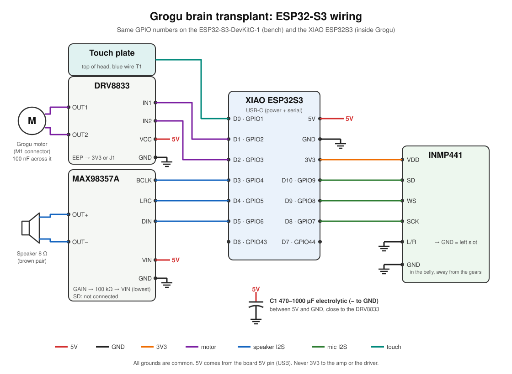

# ESP32-S3 brain

The new brain that replaces Grogu's original board: an ESP32-S3 with an I2S microphone, an I2S amplifier, a motor driver and the head touch plate. This folder holds the wiring and the bring-up firmware used to check every module before the voice pipeline exists.



## Parts

| Part | Role |
| --- | --- |
| ESP32-S3-DevKitC-1 N16R8 | Breadboard prototype and test bench |
| Seeed XIAO ESP32S3 | Final board, inside the plush |
| INMP441 | I2S microphone |
| MAX98357A | I2S amplifier for the speaker |
| DRV8833 | Motor driver (first channel only: IN1/IN2, OUT1/OUT2) |
| 8 Ω 2 W speaker | Replaces the original 0.25 W speaker |
| 470-1000 µF electrolytic capacitor | 5 V bulk capacitor near the motor driver |
| 100 kΩ resistor | Sets the amplifier to its lowest gain |

## Wiring

The pin map is identical on both boards, so the same firmware runs on the bench and inside Grogu. It lives in [`bringup/pins.h`](bringup/pins.h).

| Function | GPIO | XIAO pin | Module pin |
| --- | --- | --- | --- |
| Touch plate (blue wire T1) | 1 | D0 | Plate wire |
| Motor input 1 | 2 | D1 | DRV8833 IN1 |
| Motor input 2 | 3 | D2 | DRV8833 IN2 |
| Speaker bit clock | 4 | D3 | MAX98357A BCLK |
| Speaker word select | 5 | D4 | MAX98357A LRC |
| Speaker data | 6 | D5 | MAX98357A DIN |
| Mic bit clock | 7 | D8 | INMP441 SCK |
| Mic word select | 8 | D9 | INMP441 WS |
| Mic data | 9 | D10 | INMP441 SD |
| Free | 43, 44 | D6, D7 | Spare (UART TX/RX) |

Power and passive connections:

- DRV8833 VCC and MAX98357A VIN go to **5 V** (board 5V pin, fed by USB). Never to 3V3.
- INMP441 VDD goes to **3V3**. INMP441 L/R goes to GND (left channel).
- DRV8833 OUT1/OUT2 go to the motor (M1 connector), with the 100 nF capacitor across the motor terminals.
- DRV8833 EEP (sleep) must be high: either the J1 solder jumper on the module is bridged, or wire EEP to 3V3. ULT (fault output) stays unconnected for now.
- MAX98357A OUT+/OUT− go to the speaker. GAIN goes to VIN through 100 kΩ (+3 dB, the lowest setting). SD stays unconnected.
- One 470-1000 µF electrolytic between 5 V and GND, close to the DRV8833 (negative leg to GND): on the breadboard rails next to the module on the bench, soldered across the DRV8833 VCC and GND pins inside Grogu.
- All grounds are common.

### Notes

- Place the microphone in the belly, as far from the gearbox as possible.
- Test on the new 2 W speaker first: the original 0.25 W one can burn out with this amplifier.
- On the DevKitC-1 N16R8, GPIO 35-37 are used by the octal PSRAM. The pin map avoids them.
- The DevKitC-1 is wide: on a single breadboard it leaves only one free row on one side. Two breadboards side by side make wiring easier.

## Bring-up firmware

`bringup/` is an Arduino sketch that tests each module from the serial monitor.

### Build and flash

1. Arduino IDE with the **esp32 by Espressif** core, version 3.x.
2. Board: **XIAO_ESP32S3** or **ESP32S3 Dev Module** (DevKitC-1).
3. On the XIAO, set **USB CDC On Boot: Enabled** so the serial monitor works over its USB-C port. On the DevKitC-1, use the port labelled UART.
4. Open `bringup/bringup.ino`, upload, then open the serial monitor at 115200 baud.

From the command line, with [arduino-cli](https://arduino.github.io/arduino-cli/) and the same core (`brew install arduino-cli`), on the DevKitC-1 N16R8:

```bash
FQBN="esp32:esp32:esp32s3:FlashSize=16M,PSRAM=opi,PartitionScheme=app3M_fat9M_16MB"
arduino-cli compile -b "$FQBN" esp32/bringup
arduino-cli upload -b "$FQBN" -p /dev/cu.usbserial-XXXX esp32/bringup
```

`tools/grogu_serial.py` sends commands and prints the replies, so tests can be scripted instead of typed in a serial monitor:

```bash
python3 -m venv esp32/tools/.venv && esp32/tools/.venv/bin/pip install pyserial
esp32/tools/.venv/bin/python esp32/tools/grogu_serial.py --reset   # boot log and help menu
esp32/tools/.venv/bin/python esp32/tools/grogu_serial.py p g       # beep, then chirp
```

Do not touch the head while the board boots: the touch sensor calibrates itself during the first two seconds.

### Commands

| Key | Action |
| --- | --- |
| `f` / `b` / `s` | Motor forward / backward / stop (auto-stop after 3 s) |
| `+` / `-` | Motor speed up / down |
| `p` | 440 Hz beep |
| `g` | Grogu chirp |
| `v` / `V` | Volume down / up (starts at 20 %) |
| `m` | Toggle the microphone level meter |
| `r` | Record 2 s, then play it back |
| `t` | Print the raw touch value and threshold |
| `c` | Recalibrate the touch sensor |
| `h` | Help |

Touching the head plays a chirp and nudges the motor, so the touch test is visible on camera. The board LED blinks every 500 ms while the firmware runs.

### Test order

1. **LED**: it blinks, the firmware runs.
2. **Motor**: `f`, `b`, `s`, then `-` until it stops starting; note the minimum speed.
3. **Speaker**: `p`, then `g`. Raise the volume with `V` only if needed.
4. **Microphone**: `m`, talk and watch the bars move. Then `r` for a record and playback.
5. **Touch**: touch the head, Grogu chirps and moves.
6. **Everything together**: run the motor (`f`) with the meter on (`m`) to see how much gear noise the mic picks up.

### Troubleshooting

| Symptom | Likely cause |
| --- | --- |
| Board resets or speaker crackles when the motor starts | Motor noise on 5 V: check the bulk capacitor and the 100 nF across the motor |
| Mic meter stays at zero or prints "no data" | SCK and WS swapped, or L/R not tied to GND |
| Mic is very quiet or clips | Change `MIC_SHIFT` in `bringup.ino` (lower is louder) |
| Touch never triggers, or triggers by itself | Print values with `t` and adjust `TOUCH_RATIO` |
| No sound at all | Check 5 V on VIN, then BCLK/LRC/DIN order |
| Motor never turns | EEP low: bridge J1 or wire EEP to 3V3 |
| Motor only turns one way | IN1 or IN2 not connected |
